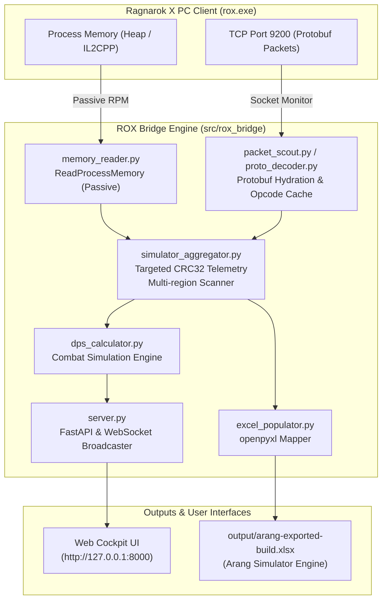

# ROX Telemetry & Simulator Bridge Architecture

## 1. System Overview

ROX Telemetry & Simulator Bridge is a high-performance, non-invasive Python observability framework for the Ragnarok X (ROX) PC client (`rox.exe`). It captures live combat attributes, advanced multipliers, counter elements, equipment profiles, divinity blessings, and shadow weapon data, then streams this telemetry to a local real-time Web Cockpit and auto-populates the Arang Damage Simulator Excel engine.

## 2. Directory Layout & Module Responsibilities

| Path | Purpose | Key Modules |
| :--- | :--- | :--- |
| `src/rox_bridge/` | Core Python application package | `simulator_aggregator.py`, `memory_reader.py`, `packet_scout.py`, `server.py`, `excel_populator.py`, `dps_calculator.py` |
| `src/rox_bridge/templates/` | HTML5/JS Dashboard templates | `dashboard.html` (Cockpit Pro Max UI) |
| `src/rox_bridge/cache/` | Runtime telemetry persistence | `character_snapshot.json` (auto-hydrated state) |
| `assets/templates/` | Master simulation templates | `arang-simulator-master.xlsx` (v2.53 DK 2H Simulator Master) |
| `assets/images/` | Static visual assets & screenshots | `dashboard-verified.png` |
| `docs/` | System & architecture documentation | `architecture.md`, `research/legacy-mobile/*.md` |
| `references/` | Large external references (Gitignored) | `RO_SEA/` (PC client install), `pc-decompiled/` (IL2CPP C# stubs) |
| `scripts/` | Tooling & offline maintenance | `map-pc-metadata.py` (PC IL2CPP metadata extractor) |
| `tests/` | Automated test suite (28 test cases) | `conftest.py`, `test_simulator_aggregator.py`, `test_excel_populator.py`, etc. |
| `output/` | Generated exports (Gitignored) | `arang-exported-build.xlsx` |

## 3. Core Principles & Safety Boundaries

1. **Non-invasive Passive Reading (100% Anti-Cheat Safe)**:
   - Uses `PROCESS_VM_READ` via standard Windows API (`ReadProcessMemory`).
   - Zero memory writes (`PROCESS_VM_WRITE`), zero DLL injections, zero API hooking.
2. **Delta Detection via Multi-Region CRC32 Telemetry**:
   - Instead of costly full memory scans every second, cached pointers read targeted chunks:
     - Combat stats block (512 bytes): Base stats, HP, SP, ATK, MATK, DEF, MDEF.
     - Details block (880 bytes): Final multipliers, PEN, Haste, ASPD, Crit, Lifesteal.
     - Counter block (1056 bytes): Size, element, race damage bonus & reduction percentages.
   - Chunks are hashed via `zlib.crc32`. If CRC32 is unchanged, no parsing or UI broadcasting occurs.
   - Full memory re-scan triggers only on cache invalidation (map transition, character relog).
3. **Dynamic Template Path Resolution**:
   - Excel templates are resolved relative to package root (`assets/templates/arang-simulator-master.xlsx`), eliminating machine-dependent absolute paths.
