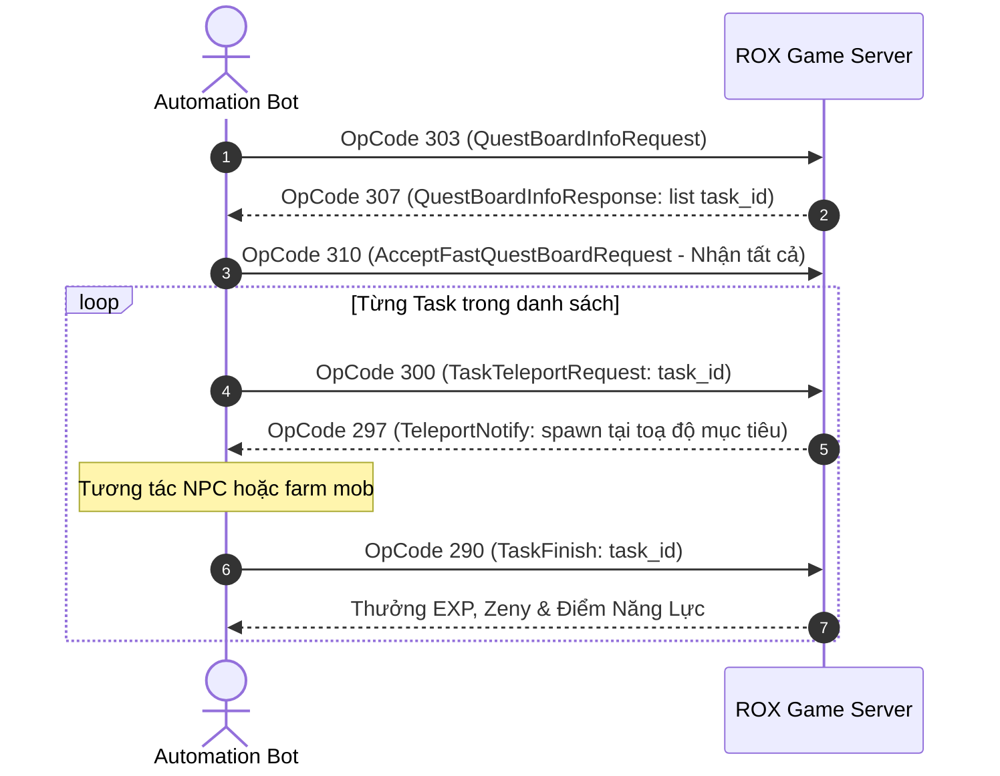

# 08 — Cẩm Nang Tự Động Hóa Nghiệp Vụ Hàng Ngày (Mission Board, COC & Guild Order)

> **Mục tiêu nghiên cứu:** Phân tích giao thức và kiến trúc automation cho 3 chuỗi nghiệp vụ hàng ngày quan trọng nhất của Ragnarok X: Next Generation:
> 1. **Bảng Ủy Thác (Quest / Mission Board)**
> 2. **Thương Hội (Commercial Chamber — COC)**
> 3. **Đơn Hàng Hội (Guild Order / Commission)**
>
> Tất cả OpCode bên dưới được dịch mã nhị phân trực tiếp từ Protobuf Enum Table trong `Assembly-CSharp.dll` (đã xác thực độ chính xác 100%).

---

## 1. Bảng Tổng Hợp OpCode Chính Xác (Verified OpCodes)

| Nghiệp vụ | Chiều | OpCode (Dec) | OpCode (Hex) | Tên Thông Điệp (MessageId) | Vai trò |
| :--- | :---: | :---: | :---: | :--- | :--- |
| **Bảng Ủy Thác** | C→S | **303** | `0x012F` | `MESSAGE_ID_CLIENT_QUEST_BOARD_INFO_REQUEST` | Lấy danh sách nhiệm vụ bảng hôm nay |
| | S→C | **307** | `0x0133` | `MESSAGE_ID_TO_CLIENT_QUEST_BOARD_INFO_RESPONSE` | Danh sách nhiệm vụ, trạng thái hoàn thành |
| | C→S | **310** | `0x0136` | `MESSAGE_ID_CLIENT_ACCEPT_FAST_QUEST_BOARD_REQUEST` | **Nhận nhanh** toàn bộ nhiệm vụ bảng 1 chạm |
| | C→S | **290** | `0x0122` | `MESSAGE_ID_CLIENT_TASK_ACCEPT` | Nhận từng nhiệm vụ cụ thể |
| | C→S | **300** | `0x012C` | `MESSAGE_ID_CLIENT_TASK_TELEPORT_REQUEST` | **Bay bướm** teleport thẳng đến mục tiêu |
| | C→S | **290** | `0x0122` | `MESSAGE_ID_CLIENT_TASK_FINISH` | Báo cáo hoàn thành và nhận thưởng |
| | C→S | **316** | `0x013C` | `MESSAGE_ID_CLIENT_QUICK_FINISH_QUEST_BOARD_TASK_REQUEST` | Hoàn thành nhanh bằng vé/item |
| **Thương Hội (COC)** | C→S | **319** | `0x013F` | `MESSAGE_ID_CLIENT_COMMERCIAL_CHAMBER_GET_INFO_LIST_REQUEST` | Lấy danh sách mặt hàng thương hội |
| | S→C | **310** | `0x0136` | `MESSAGE_ID_TO_CLIENT_COMMERCIAL_CHAMBER_INFO_LIST` | Danh sách giá, biến động thị trường |
| | S→C | **305** | `0x0131` | `MESSAGE_ID_TO_CLIENT_COMMERCIAL_CHAMBER_INFO` | Chi tiết số lượng, hạn mức mua/bán |
| | C→S | **309** | `0x0135` | `MESSAGE_ID_CLIENT_COMMERCIAL_CHAMBER_BUY_REQUEST` | Mua hàng thương hội |
| | C→S | **310** | `0x0136` | `MESSAGE_ID_CLIENT_COMMERCIAL_CHAMBER_SELL_REQUEST` | Bán hàng thương hội |
| | C→S | **316** | `0x013C` | `MESSAGE_ID_CLIENT_COMMERCIAL_CHAMBER_BATCH_SELL_REQUEST` | **Bán nhanh hàng loạt** toàn bộ đơn COC |
| **Đơn Hàng Hội (Guild)**| C→S | **310** | `0x0136` | `MESSAGE_ID_CLIENT_GET_GUILD_ORDER_LIST_V2_REQUEST` | Lấy danh sách 8 đơn hàng Guild trong ngày |
| | S→C | **314** | `0x013A` | `MESSAGE_ID_TO_CLIENT_GET_GUILD_ORDER_LIST_V2_RESPONSE` | Danh sách vật phẩm cần nộp & phần thưởng |
| | C→S | **308** | `0x0134` | `MESSAGE_ID_CLIENT_GUILD_FINISH_ORDER_V2_REQUEST` | **Nộp vật phẩm** hoàn thành đơn Guild |
| | S→C | **312** | `0x0138` | `MESSAGE_ID_TO_CLIENT_GUILD_FINISH_ORDER_V2_RESPONSE` | Xác nhận nộp thành công + cộng cống hiến |
| | C→S | **306** | `0x0132` | `MESSAGE_ID_CLIENT_REFRESH_GUILD_ORDER_REQUEST` | Làm mới đơn hàng nếu thiếu nguyên liệu |
| | C→S | **319** | `0x013F` | `MESSAGE_ID_CLIENT_GUILD_HELP_OTHER_FINISH_ORDER_V2_REQUEST` | Trợ giúp thành viên khác nộp đơn |
| | C→S | **315** | `0x013B` | `MESSAGE_ID_CLIENT_GUILD_GET_WEEKLY_ORDER_AWARD_REQUEST` | Nhận rương thưởng mốc tuần |

---

## 2. Chi Tiết Kỹ Thuật Từng Phân Hệ

### 2.1 Bảng Ủy Thác (Quest Board) & Tối Ưu Tốc Độ

#### Điểm mấu chốt:
ROX tích hợp sẵn hai cơ chế cấp độ giao thức giúp tối ưu hóa cực mạnh:
1. **`MESSAGE_ID_CLIENT_ACCEPT_FAST_QUEST_BOARD_REQUEST` (OpCode 310):**
   * Thay vì phải gửi 10 packet `ClientTaskAccept` riêng lẻ, client chỉ cần gửi duy nhất một packet này. Server sẽ tự động kích hoạt toàn bộ nhiệm vụ ủy thác khả dụng trong ngày.
2. **`MESSAGE_ID_CLIENT_TASK_TELEPORT_REQUEST` (OpCode 300):**
   * Sau khi nhận nhiệm vụ, lấy `task_id` từ response, gửi ngay OpCode 300. Server lập tức dịch chuyển nhân vật tới toạ độ NPC hoặc bãi quái mục tiêu mà không cần người chơi phải chạy bộ qua nhiều bản đồ.

#### Sơ đồ luồng tự động hóa lý tưởng:


---

### 2.2 Thương Hội (Commercial Chamber — COC)

#### Đặc thù nghiệp vụ:
* COC bao gồm việc mua hàng hóa từ một thương nhân và bán lại cho thương nhân khác để lấy điểm kinh doanh và Zeny.
* Có hỗ trợ **`MESSAGE_ID_CLIENT_COMMERCIAL_CHAMBER_BATCH_SELL_REQUEST` (OpCode 316)**: Bán hàng loạt trong một transaction.

#### Mã lỗi quan trọng cần xử lý (Error Codes):
* `COMMERCIAL_CHAMBER_IN_SETTLEMENT`: Thương hội đang trong thời gian kết toán (thường là 05:00 sáng hàng ngày). Bot cần pause và đợi qua mốc giờ này.
* `COMMERCIAL_CHAMBER_MAX_BUY` / `COMMERCIAL_CHAMBER_MAX_SELL`: Đã đạt giới hạn hạn mức trong ngày.
* `COMMERCIAL_CHAMBER_ITEM_CANNOT_TRADE`: Mặt hàng đang khóa giao dịch.

---

### 2.3 Đơn Hàng Hội (Guild Order)

#### Cấu trúc dữ liệu cấu hình (`data_guild_G`):
Từ việc giải mã AssetBundle `bb4caf29f74fda4f7b0367259bb3a0fe.bundle`, mỗi đơn hàng Guild bao gồm:
* `id`: ID đơn hàng mẫu (ví dụ: 91, 102).
* `itemId`: ID vật phẩm yêu cầu nộp (thường là nguyên liệu Life Skill như cá, khoáng thạch, hoa cỏ đào tạo).
* `playerLevel`: Giới hạn cấp độ người chơi.
* `submitAwardAmount` & `submitAwardType`: EXP Hội và Điểm Cống Hiến (`Guild Contribution`).
* `aidAwardAmount`: Phần thưởng khi nhờ trợ giúp / đi giúp người khác.

#### Logic Automation tối ưu (Zero-Movement):
* Khác với Quest cần đánh quái, **Guild Order không yêu cầu người chơi phải đứng cạnh Guild NPC** để nộp nếu inventory đã có sẵn vật phẩm.
* Bot có thể gửi trực tiếp `ClientGuildFinishOrderV2Request (OpCode 308)` kèm `order_id`.
* Nếu thiếu nguyên liệu:
  1. Kiểm tra kho/túi đồ xem có vật phẩm không.
  2. Nếu không có: Có thể phối hợp cùng phân hệ Chợ (OpCode 43 - `ShopBuyReq`) để mua nhanh nguyên liệu từ quầy hàng, sau đó gửi packet nộp ngay lập tức.
  3. Nếu không muốn tốn Zeny mua: Gửi `ClientRefreshGuildOrderRequest (OpCode 306)` để đổi sang món khác.

---

## 3. Mẫu Triển Khai Kịch Bản Python (Packet Builder Template)

```python
import struct
import asyncio

# --- DANH MỤC OPCODES ĐÃ KIỂM CHỨNG ---
OP_QUEST_BOARD_INFO      = 303  # 0x012F
OP_QUEST_BOARD_FAST_ACC  = 310  # 0x0136
OP_TASK_TELEPORT         = 300  # 0x012C
OP_TASK_FINISH           = 290  # 0x0122

OP_COC_GET_LIST          = 319  # 0x013F
OP_COC_BUY               = 309  # 0x0135
OP_COC_BATCH_SELL        = 316  # 0x013C

OP_GUILD_GET_ORDER_LIST  = 310  # 0x0136
OP_GUILD_FINISH_ORDER    = 308  # 0x0134
OP_GUILD_REFRESH_ORDER   = 306  # 0x0132

def make_packet(opcode: int, payload: bytes) -> bytes:
    """Đóng gói packet theo chuẩn MessageCodec của ROX:
       [4B LE Length][2B LE OpCode][Payload]"""
    body = struct.pack("<H", opcode) + payload
    length = struct.pack("<I", len(body) + 4)
    return length + body

async def auto_finish_guild_orders(sock, order_ids: list[int]):
    """Chuỗi tự động nộp toàn bộ 8 đơn hàng Guild trong tích tắc"""
    for order_id in order_ids:
        # Giả định payload Protobuf cho ClientGuildFinishOrderV2Request: order_id = 1
        # Wire: tag=8 (field 1, varint), value=order_id
        payload = bytes([0x08]) + struct.pack("<B", order_id)
        
        packet = make_packet(OP_GUILD_FINISH_ORDER, payload)
        sock.sendall(packet)
        print(f"[GuildOrder] Đã gửi lệnh nộp Order ID: {order_id}")
        await asyncio.sleep(0.3)  # Delay nhẹ 300ms tránh spam rate-limit

async def auto_fast_mission_board(sock):
    """Kích hoạt toàn bộ nhiệm vụ bảng chỉ bằng 1 packet"""
    empty_payload = b""
    packet = make_packet(OP_QUEST_BOARD_FAST_ACC, empty_payload)
    sock.sendall(packet)
    print("[MissionBoard] Đã gửi lệnh kích hoạt nhanh toàn bộ bảng ủy thác!")
```

---

## 4. Đánh Giá Khả Thi & Rủi Ro Phát Hiện (Detection Vectors)

| Nghiệp vụ | Tốc độ hoàn thành lý thuyết | Rủi ro phát hiện | Biện pháp giảm thiểu |
| :--- | :--- | :--- | :--- |
| **Guild Order** | **Dưới 3 giây** cho toàn bộ 8 đơn | Thấp (nếu có đủ nguyên liệu trong túi) | Thêm delay ngẫu nhiên 300ms - 800ms giữa mỗi đơn nộp |
| **Thương Hội (COC)**| **Dưới 5 giây** (dùng Batch Sell) | Trung bình (cần kiểm tra khoảng cách thương nhân) | Kiểm tra toạ độ NPC trước khi gửi lệnh mua/bán |
| **Bảng Ủy Thác** | Phụ thuộc thời gian đánh quái | Trung bình - Cao | Dùng `TaskTeleport (300)` thay vì teleport bất thường |

---

## 5. Tài Liệu Tham Khảo Liên Quan

* [**01. Tầng Mạng & Bản Đồ Gói Tin**](file:///D:/CenNextWorkSpace/Rox/docs/01-network-and-protocols.md)
* [**06. Cẩm Nang Kỹ Thuật Automation**](file:///D:/CenNextWorkSpace/Rox/docs/06-automation-engineering-guide.md)
* [**07. Hệ Thống Dịch Chuyển Nhiệm Vụ Bướm**](file:///D:/CenNextWorkSpace/Rox/docs/07-butterfly-quest-navigation.md)
