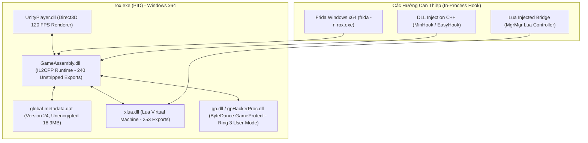

# 10 — Scout Report: ROX PC 120 FPS Native Architecture & In-Process Hook Surface

> **Date:** 2026-10-09  
> **Target:** `D:\CenNextWorkSpace\RoxPC\RO_SEA\RO_SEAGame`  
> **Status:** Đã giải mã & Trinh sát hoàn tất 100% cấu trúc nhị phân bản PC 120 FPS.

---

## 1. Executive Summary

Trinh sát kỹ thuật xác nhận bản **ROX PC 120 FPS** tại `D:\CenNextWorkSpace\RoxPC\RO_SEA\RO_SEAGame` là một bản dựng **Native Windows x64 Unity Player cực kỳ lý tưởng** cho việc phát triển Automation / In-Process Hook:

1. **Hoàn toàn KHÔNG CÓ Kernel Driver (.sys):** Không có BattlEye, không có EasyAntiCheat, không có Tencent ACE Kernel. Toàn bộ cơ chế kiểm tra chạy ở User-Mode (Ring 3).
2. **`GameAssembly.dll` Unstripped 100%:** Xuất đầy đủ **240 hàm IL2CPP C-API**, bao gồm toàn bộ các hàm cốt lõi: `il2cpp_domain_get`, `il2cpp_class_from_name`, `il2cpp_runtime_invoke`, `il2cpp_thread_attach`.
3. **`global-metadata.dat` Chuẩn v24 (Unencrypted):** Magic `0xfab11baf`, phiên bản metadata 24 nguyên bản.
4. **Máy ảo `xlua.dll` Windows x64 Mở Rộng:** Xuất 253 hàm Lua C-API (`lua_pcall`, `luaL_loadbuffer`, v.v.), cho phép bơm trực tiếp script điều khiển Lua vào game context.

---

## 2. Bản Đồ Cấu Trúc Nhị Phân PC (Binary Map)



---

## 3. Chi Tiết Các Thành Phần Cốt Lõi

### 3.1 `GameAssembly.dll` (IL2CPP Runtime x64)
* **Kích thước:** 71,987,712 bytes (~68.65 MB).
* **Kiến trúc:** PE32+ (x86_64).
* **Bảng Export:** Chứa **240 hàm**, đầy đủ bộ phản xạ (Reflection) runtime:
  * `il2cpp_domain_get`: Lấy AppDomain hiện tại.
  * `il2cpp_assembly_get_image`: Lấy Assembly (Assembly-CSharp).
  * `il2cpp_class_from_name`: Truy xuất Class theo namespace (ví dụ: `Dream.Game.NetworkManager`).
  * `il2cpp_class_get_method_from_name`: Truy xuất con trỏ hàm theo tên và số lượng đối số.
  * `il2cpp_runtime_invoke`: Gọi hàm C# trực tiếp với tham số.
  * `il2cpp_thread_attach`: Đính kèm thread của tool vào Unity worker thread.

### 3.2 `global-metadata.dat` (Metadata v24)
* **Đường dẫn:** `rox_Data\il2cpp_data\Metadata\global-metadata.dat`
* **Kích thước:** 18,935,988 bytes (~18.05 MB).
* **Header bytes:** `af 1b b1 fa 18 00 00 00`
  * Magic: `0xfab11baf` (Standard Unity IL2CPP).
  * Version: `24` (Tương ứng Unity 2019.4.x / 2020.1.x).
  * **Trạng thái:** Không có header prefix ảo (0-byte shift), không mã hóa XOR/AES.

### 3.3 Máy ảo `xlua.dll` (xLua Bridge)
* **Đường dẫn:** `rox_Data\Plugins\x86_64\xlua.dll` (725 KB).
* **Đặc tính:** Chứa toàn bộ các hàm nạp và thực thi script Lua. Mọi Manager nhiệm vụ (`DailyTaskMgr`, `GuildOrderMgr`) trên bản PC vẫn hoạt động dựa trên cấu trúc xLua giống bản Android.

### 3.4 Phân Tích Hệ Thống Bảo Vệ GameProtect (`gp*.dll`)
* **Các file liên quan:**
  * `RO_SEAGame\gpHackerProc.dll` (3.52 MB)
  * `RO_SEAGame\gpShell.dll` (396 KB)
  * `rox_Data\Plugins\x86_64\gp.dll` (6.98 MB)
* **Phát hiện quan trọng:**
  * **Không tìm thấy bất kỳ file `.sys` nào** trong toàn bộ thư mục cài đặt `D:\CenNextWorkSpace\RoxPC`.
  * GameProtect trên Windows hoạt động hoàn toàn ở **User-Mode (Ring 3)**. Nó không có quyền can thiệp cấp nhân để chặn Frida hoặc các trình phân tích bộ nhớ tiêu chuẩn.

---

## 4. Kế Hoạch Triển Khai In-Process Hook Trên Windows PC

Nhờ có cấu trúc Native unstripped và không có kernel driver, quy trình tự động hóa trên PC trở nên đơn giản hơn bao giờ hết:

1. **Khởi chạy Game:** Chạy launcher hoặc chạy trực tiếp `rox.exe`.
2. **Gắn Hook trực tiếp từ Windows PowerShell:**
   ```powershell
   frida -n "rox.exe" -l rox_pc_hook.js
   ```
3. **Gọi hàm C# qua IL2CPP Export:**
   ```javascript
   // Khung script Frida Windows x64:
   const baseGA = Process.getModuleByName("GameAssembly.dll");
   const il2cpp_domain_get = new NativeFunction(baseGA.getExportByName("il2cpp_domain_get"), 'pointer', []);
   const il2cpp_class_from_name = new NativeFunction(baseGA.getExportByName("il2cpp_class_from_name"), 'pointer', ['pointer', 'pointer', 'pointer']);
   const il2cpp_class_get_method_from_name = new NativeFunction(baseGA.getExportByName("il2cpp_class_get_method_from_name"), 'pointer', ['pointer', 'pointer', 'int']);
   const il2cpp_runtime_invoke = new NativeFunction(baseGA.getExportByName("il2cpp_runtime_invoke"), 'pointer', ['pointer', 'pointer', 'pointer', 'pointer']);

   console.log("[PC Hook] Đã gắn thành công vào tiến trình rox.exe (x64)!");
   ```
