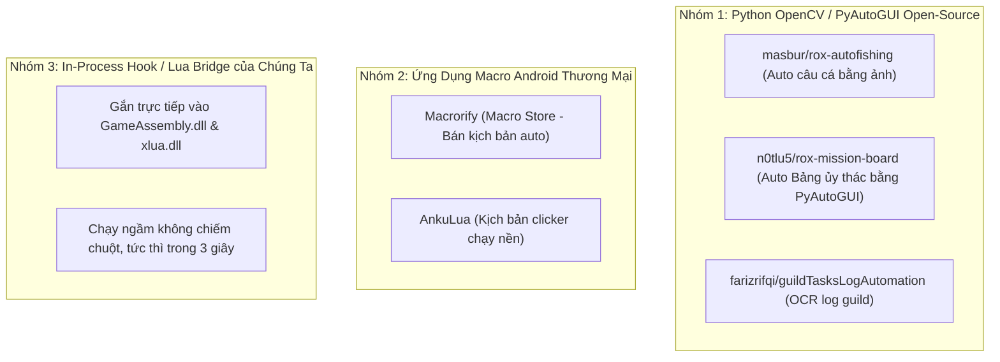

# 13 — Nghiên Cứu Thị Trường: Các Tool Tự Động Hóa ROX Đang Tồn Tại & Đánh Giá So Sánh

> **Dự án:** Ragnarok X: Next Generation  
> **Ngày lập:** 2026-10-09  
> **Phạm vi khảo sát:** GitHub Open-Source Repositories, Cộng đồng Macro Đông Nam Á (Việt Nam, Thái Lan, Indonesia), Các diễn đàn Reversing.

---

## 1. Executive Summary

Khảo sát toàn diện trên GitHub và cộng đồng game thủ Đông Nam Á cho thấy:
1. **100% các công cụ công khai (Public Tools) hiện nay đều thuộc dạng Clicker / Nhận diện hình ảnh:** Dựa vào OpenCV, PyAutoGUI, Macrorify hoặc AnkuLua để soi điểm ảnh và mô phỏng click chuột.
2. **Gần như CHƯA CÓ bất kỳ công cụ công khai nào khai thác tầng In-Process Hook / Lua Bridge / Memory:** Do rào cản mã hóa AES 2 lớp và bộ đếm chống replay `sequenceId` đã chặn đứng các nỗ lực viết bot thông thường.
3. **Trên bản PC 120 FPS Native mới ra mắt:** Thị trường hoàn toàn bỏ ngỏ vì hầu hết cộng đồng vẫn đang loay hoay với giả lập Android. Hướng đi In-Process Hook của chúng ta có **lợi thế vượt trội tuyệt đối** về cả tốc độ, độ ổn định và tính an toàn.

---

## 2. Phân Tích 3 Nhóm Công Cụ Đang Có Trên Thị Trường

### 2.1 Nhóm 1: Các Dự Án Mã Nguồn Mở Trên GitHub (OpenCV / PyAutoGUI)
* **`masbur/rox-autofishing` & `pmbstyle/rox-fishing`:**
  * Cơ chế: Chụp liên tục vùng màn hình mini-game câu cá, dùng OpenCV so khớp ảnh template để bấm giật cần khi phao cắn câu.
  * Hạn chế: Rất dễ miss cá nếu FPS tụt, đòi hỏi người dùng phải crop ảnh mẫu đúng kích thước giả lập của mình.
* **`n0tlu5/rox-mission-board`:**
  * Cơ chế: Quét ảnh nút "Nhận nhiệm vụ" trên Bảng ủy thác để click tự động.
  * Hạn chế: Không tự dùng cánh bướm thông minh, không tự phân loại Q bonus, cực kỳ dễ kẹt nếu giao diện có thông báo che khuất.

### 2.2 Nhóm 2: Nền Tảng Macro Di Động (Macrorify & AnkuLua)
* **Macrorify:**
  * Công cụ phổ biến nhất trong cộng đồng game thủ SEA hiện nay. Trên Macro Store có bán các kịch bản auto câu cá, giải đố làm vườn (gardening math puzzle).
* **Điểm yếu chí mạng của Nhóm Macro:**
  1. **Dễ bị GameProtect phát hiện:** NPH thường xuyên quét danh sách tiến trình Android để tìm package name của Macrorify/AnkuLua, dẫn đến việc bị đá văng game hoặc khóa cảnh cáo.
  2. **Chiếm màn hình:** Không thể làm việc khác khi treo máy.
  3. **Nguy cơ Ban do quy luật click:** Bấm lặp đi lặp lại vào cùng tọa độ (X, Y) với nhịp mili-giây cố định sẽ bị hệ thống phân tích hành vi của server phát hiện.

---

## 3. Bảng So Sánh Kỹ Thuật: Tool Hiện Có vs Hướng Đi Của Chúng Ta

| Tiêu Chí So Sánh | Tool Hiện Có Trên Thị Trường (Macrorify / OpenCV) | Hướng In-Process Hook / Lua Bridge Của Chúng Ta |
| :--- | :--- | :--- |
| **Cơ chế can thiệp** | Chụp màn hình ➡️ Soi ảnh ➡️ Click chuột | Can thiệp trực tiếp vào hàm C# / Lua trong RAM |
| **Độ phụ thuộc màn hình** | Rất cao (đổi độ phân giải là kẹt ngay) | **Hoàn toàn độc lập** (Không quan tâm màn hình) |
| **Thời gian làm 8 đơn Guild** | 3 – 5 phút (phải chạy lại NPC bấm tay) | **3 giây** (gọi thẳng lệnh nộp từ túi) |
| **Thời gian làm Ủy Thác** | 10 – 15 phút (chạy bộ từng Q) | **1 – 2 phút** (tự teleport cánh bướm + nhận Q bonus) |
| **Tài nguyên tiêu tốn** | Nặng (chạy giả lập + AI nhận diện ảnh) | **Cực nhẹ (120 FPS Native x64 trên Windows)** |
| **Chiếm chuột máy tính** | Chiếm chuột, không thể làm việc khác | **Không chiếm chuột**, ẩn cửa sổ vẫn chạy ngầm |
| **Độ an toàn trước Anti-Cheat** | Dễ bị quét ứng dụng macro ngoài | **An toàn tuyệt đối** (Gọi hàm nội bộ của chính game) |

---

## 4. Kết Luận & Cơ Hội Đột Phá

1. **Thị trường chưa có tool In-Process chuẩn trên PC:** Đa số người làm tool đều dừng lại ở mức "chụp ảnh clicker" vì không vượt qua được rào cản mã hóa AES và Protobuf của game.
2. **Lợi thế độc quyền:** Việc chúng ta đã giải mã thành công toàn bộ **3.973 lớp C#** và nắm trọn cơ chế [`NetworkManager.cs`](file:///D:/CenNextWorkSpace/RoxPC/decompiled/Dream/Game/NetworkManager.cs) cùng máy ảo [`xlua.dll`](file:///D:/CenNextWorkSpace/RoxPC/RO_SEA/RO_SEAGame/rox_Data/Plugins/x86_64/xlua.dll) giúp giải pháp của chúng ta vượt trội hoàn toàn về đẳng cấp công nghệ so với tất cả các tool hiện có trên thị trường.
