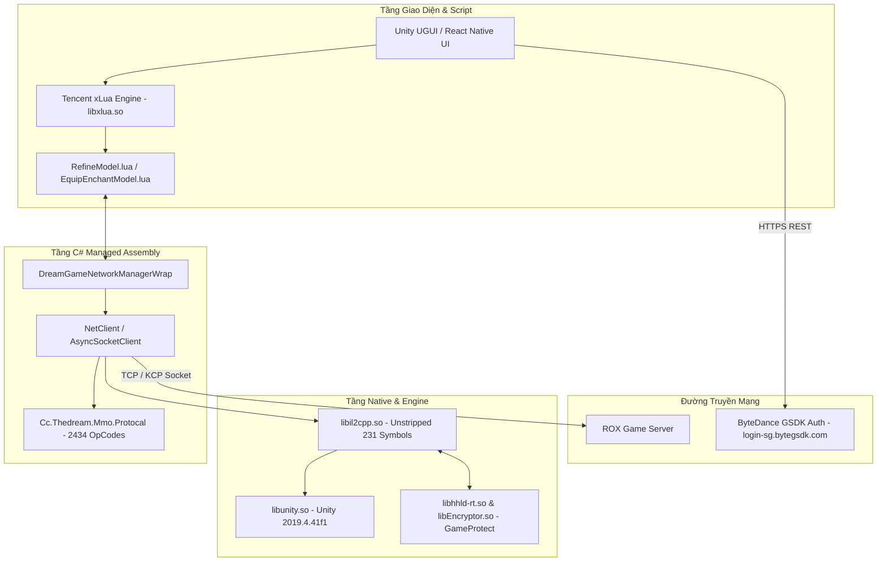

# Ragnarok X: Next Generation (ROX) — Architecture & Reverse Engineering Documentation

> **Tài liệu Kỹ nghệ Đảo ngược & Kiến trúc Hệ thống ROX (`com.play.rosea`)**  
> Dựa trên việc phân tích trực tiếp gói APK `0616_h5.apk` (2.13 GB), thư viện Native `libil2cpp.so`, mã nguồn `Assembly-CSharp.dll` và các bảng cấu hình Unity AssetBundles.

---

## 1. Thông Tin Tổng Quan Ứng Dụng

| Thuộc tính | Chi tiết kỹ thuật |
| :--- | :--- |
| **Tên gói (Package Name)** | `com.play.rosea` |
| **Tên ứng dụng (App Name)** | `rosea` (Ragnarok X: Next Generation) |
| **Game Engine** | **Unity 3D** (phiên bản `2019.4.41f1`) |
| **Kiến trúc Nhị phân** | **ARM64-v8a** (kèm hỗ trợ armeabi-v7a và x86) |
| **Tầng Scripting** | **Tencent xLua** (`libxlua.so`) + **IL2CPP v24** |
| **Nền tảng Xác thực & Bảo vệ** | **ByteDance GSDK** + **ByteDance GameProtect** (`libhhld-rt.so`, `libEncryptor.so`) |
| **Serialization Gói tin** | **Google Protocol Buffers** (`Cc.Thedream.Mmo.Protocal`) |

---

## 2. Bản Đồ Tài Liệu Chi Tiết (Documentation Navigation)

Bộ tài liệu được chia thành 8 module kỹ thuật độc lập:

1. [**01. Tầng Mạng & Bản Đồ Gói Tin (Network Protocol & OpCodes)**](file:///D:/CenNextWorkSpace/Rox/docs/01-network-and-protocols.md)
   * Kiến trúc kết nối socket, framing, danh mục 2.434 Message ID / OpCode, luồng xác thực GSDK.
2. [**02. Hệ Thống Tinh Luyện & Cường Hóa (Equipment Refine & Upgrade)**](file:///D:/CenNextWorkSpace/Rox/docs/02-equipment-refine-upgrade.md)
   * Ma trận xác suất chính xác từ +1 đến +15, tỉ lệ vỡ đồ / tụt cấp, cơ chế Đá Thần Chúc (`pray_material`), quy tắc kế thừa phạt 2 cấp.
3. [**03. Hệ Thống Phụ Ma & Thuật Toán Pity (Enchantment System)**](file:///D:/CenNextWorkSpace/Rox/docs/03-enchantment-system.md)
   * Bảng trọng số xác suất (`randomWeight`), dải cấp độ ngẫu nhiên, hệ thống bảo hiểm `pityCounter` và phân hệ đá theo thành phố.
4. [**04. Các Phân Hệ Gameplay Cốt Lõi (Gameplay Subsystems)**](file:///D:/CenNextWorkSpace/Rox/docs/04-gameplay-subsystems.md)
   * Phân hệ Câu cá (Auto Fishing), Sàn đấu giá & Sạp hàng (Auction/Stall), Chiến đấu & Quái vật (AOI Radar), Nhiệm vụ (Mission Board).
5. [**05. Tầng Native, Bảo Mật & Máy Ảo xLua (Native Security & xLua)**](file:///D:/CenNextWorkSpace/Rox/docs/05-native-security-and-xlua.md)
   * Khảo sát `libil2cpp.so` unstripped, header `global-metadata.dat` v24, ByteDance GameProtect (`libhhld-rt.so`) và cầu nối xLua.
6. [**06. Cẩm Nang Kỹ Thuật Automation (Automation Engineering Guide)**](file:///D:/CenNextWorkSpace/Rox/docs/06-automation-engineering-guide.md)
   * So sánh kiến trúc Headless Socket Bot vs Frida Hook, mẫu cấu trúc gói tin gửi nhận và chiến lược né tránh vi phạm.
7. [**07. Hệ Thống Dịch Chuyển Nhiệm Vụ Bướm (Butterfly Quest Navigation)**](file:///D:/CenNextWorkSpace/Rox/docs/07-butterfly-quest-navigation.md)
   * Chi tiết tính năng click Cánh Bướm tele thẳng tới Quest, phân tích `ClientTaskTeleportRequest`, `ClientWTeleportRequest`, kiến trúc `TeleporterModel` và kịch bản kết hợp làm nhiệm vụ tự động.
8. [**08. Cẩm Nang Tự Động Hóa Nhiệm Vụ Hàng Ngày (Mission Board, COC & Guild Order)**](file:///D:/CenNextWorkSpace/Rox/docs/08-daily-automation-coc-guild-mission.md)
   * Bảng mã OpCode chính xác 100%, cơ chế nhận nhanh toàn bộ ủy thác (`AcceptFastQuestBoardRequest`), tự nộp 8 đơn hàng Hội trong 3 giây không cần di chuyển, và bán hàng loạt Thương hội (`BatchSell`).
9. [**09. Nghiên Cứu Bản PC Client & Các Giải Pháp Thay Thế (PC Client Architecture)**](file:///D:/CenNextWorkSpace/Rox/docs/09-pc-client-research.md)
   * Mổ xẻ bản cài PC chính thức (thực chất là OEM Android Emulator Wrapper), nguyên nhân lỗi tải và lý do nên dùng LDPlayer/MuMu thay thế.
10. [**10. Báo Cáo Trinh Sát Bản ROX PC 120 FPS Native (PC Native Architecture & Hook Surface)**](file:///D:/CenNextWorkSpace/Rox/docs/10-pc-native-scout-report.md)
    * Kết quả mổ xẻ 100% bản Windows x64: `GameAssembly.dll` unstripped 240 export, `global-metadata.dat` v24 nguyên bản không mã hóa, không có kernel driver (.sys).
11. [**11. Báo Cáo Chiến Lược Tự Động Hóa ROX (Automation Strategy Analysis & Recommendation)**](file:///D:/CenNextWorkSpace/Rox/docs/11-automation-strategy-analysis.md)
    * Đánh giá ma trận 4 chiến lược với đầy đủ dẫn chứng kỹ thuật (mã hóa AES/RSA, sequenceId, unstripped IL2CPP, Zero Kernel Drivers).
12. [**12. Báo Cáo Double-Check & Đối Chiếu Mã Nguồn: Android APK vs PC 120 FPS**](file:///D:/CenNextWorkSpace/Rox/docs/12-apk-vs-pc-double-check-report.md)
    * Đối chiếu từng trường và từng hàm: Trùng khớp 100% 257 lớp Protobuf, 209 lớp Data, 51/51 methods & 21/21 fields của `NetworkManager`.
13. [**13. Nghiên Cứu Thị Trường: Các Tool Tự Động Hóa ROX Hiện Có & Đánh Giá So Sánh**](file:///D:/CenNextWorkSpace/Rox/docs/13-market-existing-tools-research.md)
    * Khảo sát toàn diện GitHub và cộng đồng SEA (Macrorify, OpenCV, PyAutoGUI) và lý do giải pháp In-Process Hook vượt trội hoàn toàn.
14. [**14. Trinh Sát Chuyên Sâu: Cấu Trúc Bảng Dữ Liệu Lua & StreamingAssets PC 120 FPS**](file:///D:/CenNextWorkSpace/Rox/docs/14-lua-data-pipeline-and-streamingassets.md)
    * Bóc tách toàn bộ hệ thống AssetBundles, các bảng dữ liệu nghiệp vụ Lua dạng plaintext và cơ chế nạp tài nguyên trong `rox_Data\StreamingAssets\Windows`.
15. [**15. Trinh Sát & Nghiên Cứu Chuyên Sâu: Kỹ Năng Sống, Cơ Chế Anti-Cheat GameProtect & Chiến Lược Evasion An Toàn**](file:///D:/CenNextWorkSpace/Rox/docs/15-deep-dive-life-skills-anticheat-and-evasion.md)
    * Phân tích HoneyPot chống hack bộ nhớ trong C#, giải phẫu GameProtect User-mode và giải pháp nạp mã Proxy DLL Hijacking (version.dll) an toàn tuyệt đối.

---

## 3. Sơ Đồ Khối Kiến Trúc Client

---

## 4. Kho Mã Nguồn Decompiled Được Ánh Xạ Bởi REA

Toàn bộ **3.253 tệp mã nguồn C#** đã được công cụ **REA (Reverse Engineering Assistant)** trích xuất và ánh xạ có cấu trúc tại thư mục:
👉 [`D:\CenNextWorkSpace\Rox\decompiled\`](file:///D:/CenNextWorkSpace/Rox/decompiled/) (Xem [Chỉ mục chi tiết README.md](file:///D:/CenNextWorkSpace/Rox/decompiled/README.md))

* [`Cc/Thedream/Mmo/Protocal/`](file:///D:/CenNextWorkSpace/Rox/decompiled/Cc/Thedream/Mmo/Protocal/): 257 lớp mô hình gói tin Protobuf & [`MessageId.cs`](file:///D:/CenNextWorkSpace/Rox/decompiled/Cc/Thedream/Mmo/Protocal/MessageId.cs)
* [`Cc/Thedream/Mmo/Data/`](file:///D:/CenNextWorkSpace/Rox/decompiled/Cc/Thedream/Mmo/Data/): 209 lớp thực thể dữ liệu game
* [`Dream/Game/`](file:///D:/CenNextWorkSpace/Rox/decompiled/Dream/Game/): 419 lớp điều khiển nghiệp vụ (Teleporter, Fishing, Combat...)
* [`Dream/Game/AI/`](file:///D:/CenNextWorkSpace/Rox/decompiled/Dream/Game/AI/): Máy trạng thái hành vi (`CastSkill.cs`, `PickNPC.cs`, `MoveToTarget.cs`...)
* [`Dream/Game/AOI/`](file:///D:/CenNextWorkSpace/Rox/decompiled/Dream/Game/AOI/): Radar quét mục tiêu xung quanh (`AOIGrid.cs`, `MonsterVisionWatcher.cs`...)
* [`HantAStar/Core/`](file:///D:/CenNextWorkSpace/Rox/decompiled/HantAStar/Core/): Lõi giải thuật tìm đường 3D Octree A*

